# Hollis & Sons — Launch round

16 production images in 32 art files: 12 transparent PNGs, 4 black-and-white JPGs, and 16 lossless WebPs. [manifest.json](manifest.json) records filenames, dimensions, descriptions, hashes, references and imagegen prompts. [qa.json](qa.json) records the size, transparency, grayscale, WebP and stage-registration checks.

The source kit was read from `dirt-inc-rebuild`, branch `claude/save-and-tap-feel`, commit `797bfe7fc0a240330781feae90b4fa552b61e537`. All artwork was generated with imagegen against the named kit references. Exports use sheet extraction, uniform downsampling, shared-canvas registration and the requested format encoding. The existing painted 1950s forms, brown outlines, upper-left lighting and cream/teal/red/wood/brass palette are preserved. The Herald images use neutral black-and-white printing as requested, with the existing halftone grain and ink treatment.

| Deliverable | Files | Dimensions |
| --- | --- | --- |
| Normal closed / open crates | `gear/crate-closed-lg`, `gear/crate-open-lg` | 512 × 512 |
| Gold closed / open crates | `jobs/gold-crate-closed-lg`, `jobs/gold-crate-open-lg` | 512 × 512 |
| Prestige Herald photos | `jobs/herald-sold-sign`, `jobs/herald-new-shaft` | 768 × 512 |
| Granger Grain Elevator stages | `jobs/weekly-grain-elevator-1` through `-4` | 780 × 240 |
| WHSN Radio Tower stages | `jobs/weekly-radio-tower-1` through `-4` | 780 × 240 |
| Opening-day Herald photos | `jobs/herald-grain-elevator`, `jobs/herald-radio-tower` | 768 × 512 |

Transparent art has `.png` and `.webp` versions. Herald photos have `.jpg` and `.webp` versions. Each WebP has exactly the same decoded pixels as its PNG/JPG counterpart.

## Crates

| Normal closed | Normal open | Gold closed | Gold open |
| --- | --- | --- | --- |
|  |  |  |  |

The small-crate designs are retained: honey wood and riveted steel corners for normal crates, brass fittings and front gold star for gold crates. Open crates have no lid or contents. The gold light stays inside the open crate. All four were compared to their small references at **64px**, on cream, dark teal and earth backgrounds; normal/gold and closed/open remain clear.

## Weekly stage swaps

Keep each complete **780 × 240** canvas and use the common bottom-edge anchor **(390, 226)**. Empty headroom in early stages is intentional. Do not trim and independently fit each stage when importing it.

| Order | 1 · foundations | 2 · half built | 3 · scaffold | 4 · in use |
| --- | --- | --- | --- | --- |
| Grain Elevator | 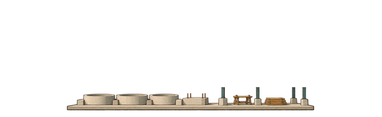 | 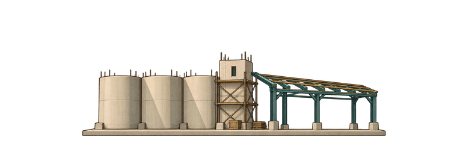 | 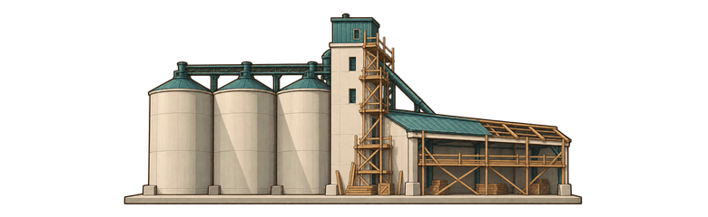 | 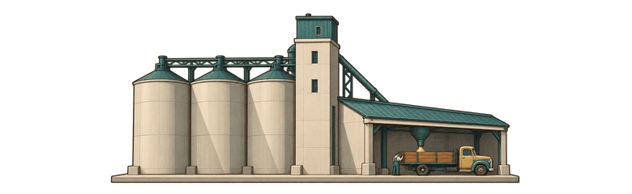 |
| Radio Tower | 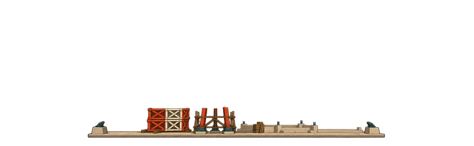 | 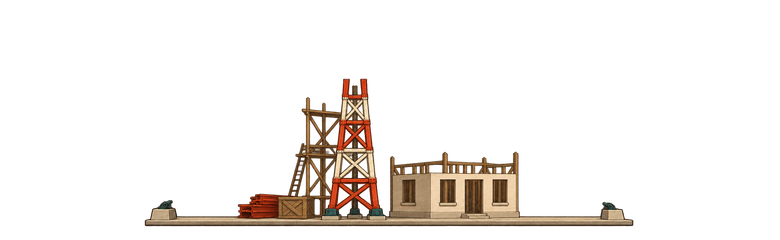 | 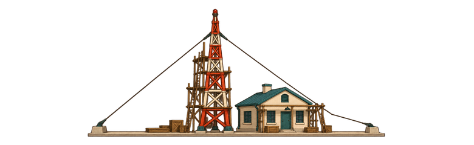 | 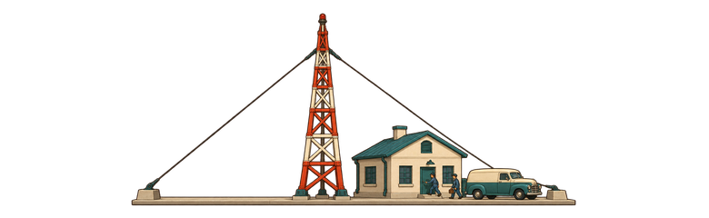 |

Every frame was reviewed at **390px wide** on cream and dark teal, in a sequential swap filmstrip and registered edge overlays. The solid site spans are identical across each family: grain elevator x=137…641, radio tower x=145…633, with the solid footing edge at y=226 in all eight frames. Matching a static lower-foundation patch against stage 4 finds **zero horizontal and vertical offset** in every earlier stage. A one-pixel radio foundation raster-rounding offset was corrected before final review.

Stage 1 is low footings and materials, stage 2 has unfinished walls and framing, stage 3 has the full building height plus prominent scaffolding, and stage 4 removes construction clutter and adds the farm truck or station crew/van. The major building positions and site footprint stay fixed.

## Herald photos

| Mine sold | New shaft |
| --- | --- |
| 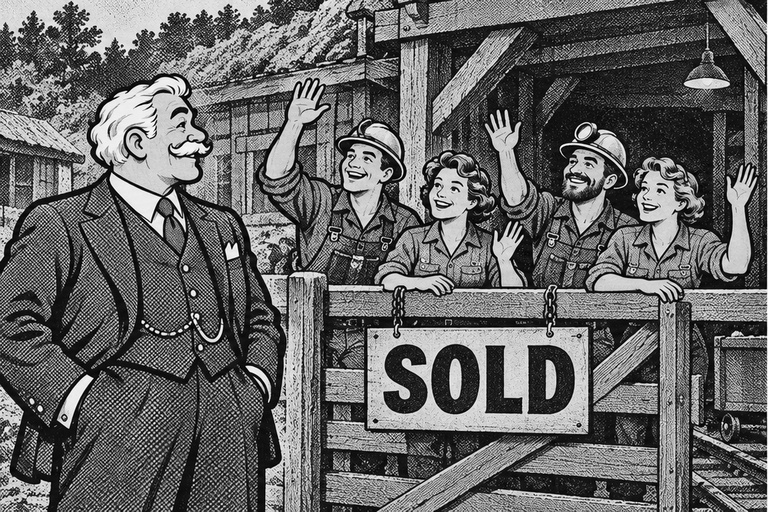 | 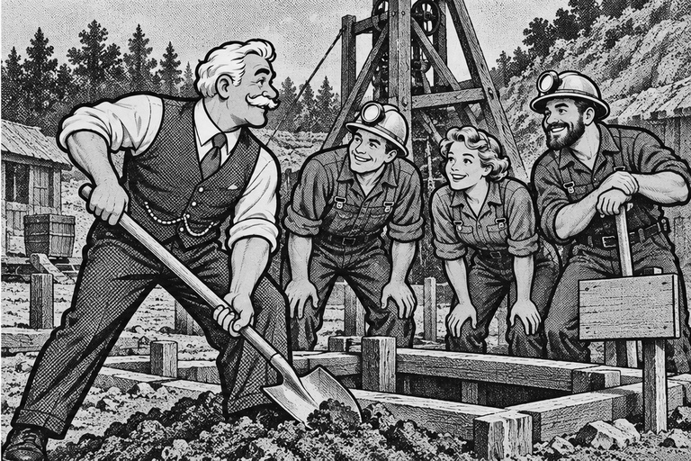 |

| Grain elevator opening | Radio tower opening |
| --- | --- |
| 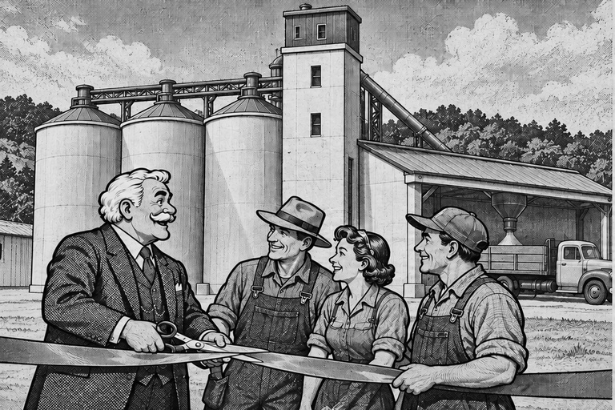 | 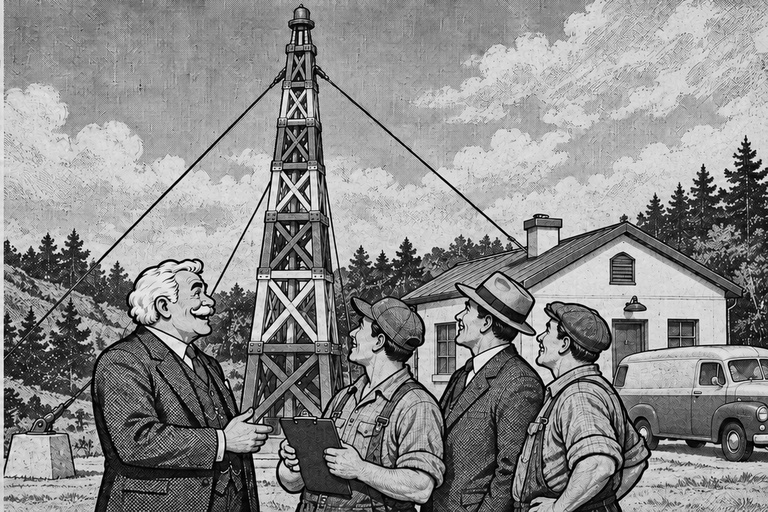 |

The Herald scenes retain Old Hollis's white swept-back hair, curled moustache, broad face, period suit/waistcoat and watch chain. All visible faces are candid profiles or averted three-quarter views. Clothing, hats, trucks and equipment follow the 1950s kit. The opening-day facilities follow the new finished landmark designs. Tiny background bystanders were removed from the grain opening scene during the final imagegen pass to satisfy the averted-face rule.

`SOLD` on the mine-gate board is the only lettering. Other signs, vehicles, buildings and clothing are unlettered. All four delivered JPGs are literal grayscale, and all four WebPs retain neutral equal RGB channels.

No game code or existing art-pack assets were edited.
