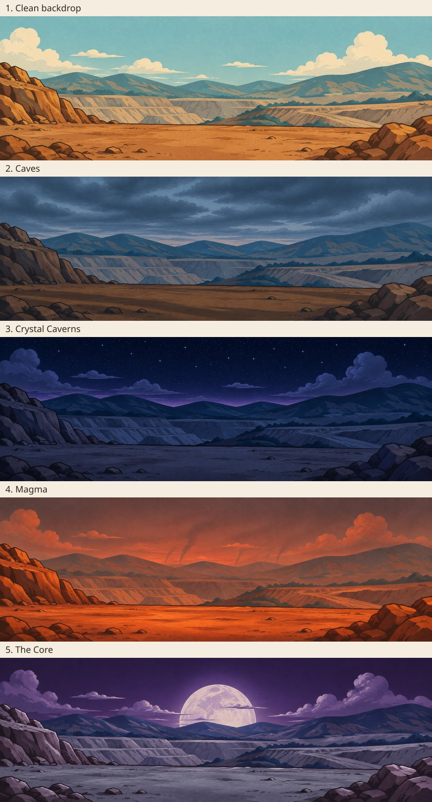

# Camp backgrounds for the five mining layers

Five opaque PNGs, each **1600 × 533 pixels**, in gameplay order. The four mood edits were generated independently from the same clean backdrop. No game code is included.

| Layer | PNG | Mood |
| --- | --- | --- |
| Surface | [Clean backdrop](backdrop-clean-1600x533.png) | Original daylight; ridge buildings and water tower removed. |
| Caves | [Caves](backdrop-caves-1600x533.png) | Heavy evening cloud, cool grey-blue light, darker ochre dirt and long soft shadows. |
| Crystal Caverns | [Crystal Caverns](backdrop-crystal-caverns-1600x533.png) | Star-filled night, faint violet horizon glow and cool, dim terrain. |
| Magma | [Magma](backdrop-magma-1600x533.png) | Ashy red-orange dusk, distant smoke columns and warm dirt. |
| The Core | [The Core](backdrop-the-core-1600x533.png) | Deep purple night, huge pale moon and nearly grey dirt. |

[Download all five PNGs as a ZIP](layer-backdrops.zip).

The clean backdrop retains the original decoded image pixels outside the ridge settlement removal area. The four mood edits closely preserve the scenery and framing, with minor generated contour and texture differences; they are not pixel-identical registrations.

`manifest.json` lists dimensions, descriptions, file sizes and SHA-256 checksums. The ZIP is the unchanged earlier delivery bundle and includes its original manifest. Labels appear only on the preview sheet, outside the individual artwork.
