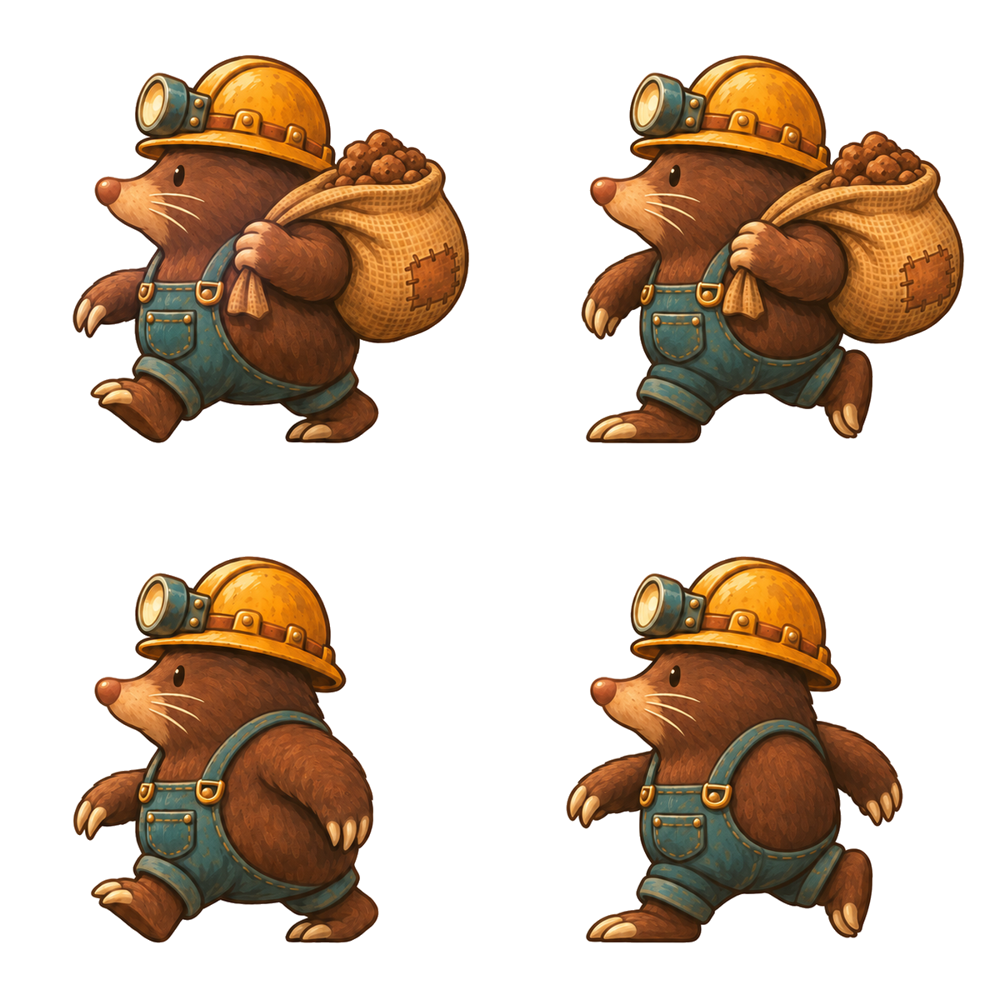

# Painted mole courier

[Open or download the 1200 × 1200 PNG](mole-courier-sheet-1200x1200.png).

Four equal 600 × 600 cells on opaque flat white. All figures face left, with matching scale and a shared local foot baseline at y=531. No labels, grid, ground shadows or scenery appear in the artwork.

| Cell | Pose |
| --- | --- |
| Top left | Left foot forward, carrying a bulging sack of dirt. |
| Top right | Right foot forward, carrying the same sack. |
| Bottom left | Left foot forward, empty-handed. |
| Bottom right | Right foot forward, empty-handed. |

Style reference: [the painted camp](../../painted-camp/painted-camp-original-1600x600.png), with warm brown outlines, upper-left lighting, ochre-yellow helmet and restrained teal accents. The first generation repeated the stride; the delivered version corrects the right column to the opposite walking phase.

`manifest.json` contains the sheet checksum and cell coordinates. This is the requested white-background sheet; game code is unchanged.
