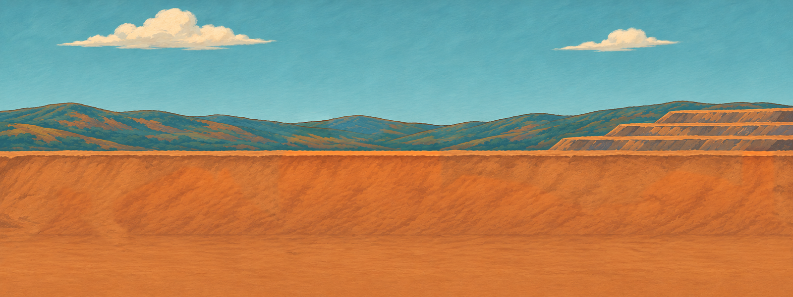

# Painted camp: original and empty background

[Open the empty 1600 × 600 PNG](painted-camp-empty-1600x600.png).

The dirt mound and flag, wash plant and water, BERTHA drill rig, cream shed, copper-coil battery bank, and brick generator house are removed. The canvas remains 1600 × 600.

For comparison:

- [Original painting](painted-camp-original-1600x600.png)
- [Removal mask](edit-mask.png): white is the removal region; grey is the blend edge.
- [Pixel verification](verification.json)
- [File sizes and SHA-256 checksums](manifest.json)

The existing imagegen fill was composited into refined removal masks. Every decoded RGB pixel outside the supplied mask is identical to the original. The mask includes the objects, cast shadows and local blending margins, so some already-visible terrain within those margins is reconstructed. No game code is included.

The removal mask is an edit footprint, not a machine transparency matte. Subtracting the empty image from the original does not by itself recover clean transparent edges. Foreground cutouts still require separate alpha masks and an edge check. No mole artwork is included in this step.
